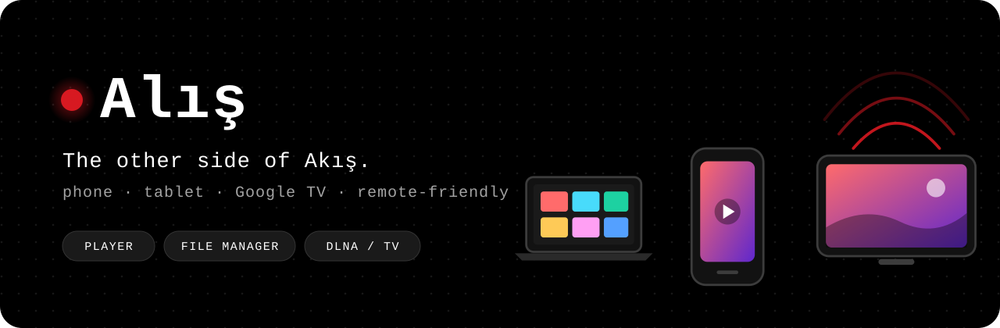

<div align="center">



<br>

**The receiver for [Akış](https://github.com/onurcakirtr/akis)** — browse, play and manage your phone's media and files
from another phone, a tablet or **Google TV**.

[](https://github.com/onurcakirtr/alis/releases/latest)
[](https://github.com/onurcakirtr/alis/actions/workflows/build.yml)
[](https://github.com/onurcakirtr/alis/releases)
<br>


**[🇬🇧 English](#-english)** · **[🇹🇷 Türkçe](#-türkçe)**

</div>

---

<details open id="-english">
<summary><b>🇬🇧 English</b></summary>

<br>

Akış turns a phone into a media and file server. **Alış** (*receiving*) is the other side: it finds Akış servers
(and any UPnP/DLNA media server) on your Wi-Fi and gives you everything the Akış web interface has — as a native app —
plus a full video player and a file manager.

## ✨ Highlights

- **Finds servers by itself** (SSDP). Add by address, QR code or an `https://` remote (Cloudflare Tunnel) address.
- **Two interfaces in one APK:** phone/tablet (bottom bar or side rail, list–detail) and a **separate Google TV interface**
  (focus-expanding rail, big cards, rows, the focused item's picture in the background). Everything works with a remote.
- **Video player** in the spirit of VLC, in Akış's look: audio and subtitle tracks, **subtitle and audio delay**, speed 0.25–4×,
  aspect ratio, equalizer and volume boost, playlist, repeat / shuffle, jump to time, lock, PiP, gestures (seek, volume, brightness),
  remote keys. MKV, HEVC; AC3/DTS fall back to Akış's on-the-fly conversion when the device can't decode them.
  **Resume position is synced with Akış both ways.**
- **Music** in the background with notification / lock-screen controls, queue and shuffle. **Photos** with zoom and slideshow.
- **File manager** for the phone's whole storage: browse, **cut / copy / paste, delete, rename, new folder**, download files,
  folders (ZIP) and selections, upload here. Editing is allowed **only for paired Alış devices** that Akış gives permission to.
- **Pairing without codes:** pick the server, tap *Pair*, then *Allow* in the notification on the phone. (Or turn on
  *Trust this network* in Akış.) Paired devices skip approval and PIN on the local network.
- Phone tools: status, installed apps (download / install APKs), live camera / screen / microphone, notification mirroring,
  received files, **admin panel**.
- **Downloads** that survive interruptions and play offline, **share menu → Alış → Akış**, file request and share links.
- **DLNA player mode:** Alış shows up as a renderer — Windows *Cast to device*, BubbleUPnP and others can play on it.
- Google TV home screen **Continue watching** row.
- 12 themes, light / dark, English and Turkish. **Every feature has its own switch**; sensitive ones are off by default.

## 🚀 Install

Download **`Alis-x.y.z.apk`** from [**Releases**](https://github.com/onurcakirtr/alis/releases/latest) and open it on the phone, tablet or TV (Android 10+).
On Google TV: install with a file manager or `adb install Alis-x.y.z.apk`.
Akış and Alış are released together with the same version number — use the same version on both sides.

**Updates:** once a day Alış asks GitHub for the latest release and offers to install it (Android always asks you to confirm).
Only that one question is sent; you can turn it off in *Settings → About*.

> [!IMPORTANT]
> **Google Play Protect** checks every app that isn't from the Play Store and may show a warning.
> Alış is open source (GPL-3.0); every APK is built by GitHub Actions from this repository and signed with the same key.
> If you see a warning, tap **More details → Install anyway**.

You need **Akış 1.x with pairing** (this repository's version) for pairing and file management; everything else also works with older Akış.

**Build it yourself:** open the folder in Android Studio (JDK 25) → *Build → Build APK(s)*.

## 🔗 With Akış

| In Akış | What it enables in Alış |
|---|---|
| Settings → Alış → *Pair Alış* / notification *Allow* | Pairing (no approval / PIN on the local network) |
| Settings → Alış → *Trust this network* | Pairing requests accepted automatically |
| Features → All files + *File management* + per-device switch | File manager editing |
| Web features (status, apps, camera…) | The matching tools in Alış (also need Alış's own switch) |

## 🧩 Structure

```
app/            Phone/tablet UI (mobile/), Google TV UI (tv/), player (player/), shared screens (ui/), background services
core/model      Data classes
core/discovery  SSDP discovery, device descriptions
core/upnp       ContentDirectory client, DIDL-Lite, DLNA renderer (DMR)
core/akis       Akış API client (access flows, pairing, files, admin)
core/data       Settings and feature switches (DataStore), servers, encrypted cookies, unified library, downloads/uploads
core/player     Media3 setup, music service, track tools, audio delay
core/ui         12 themes, components, focus ring, device type, language
tools/strings.py   All texts (English + Turkish) → strings.xml
```

**Add a language:** add a column to `tools/strings.py`, run it, and add the code to `Lang.SUPPORTED` (`core/ui/Device.kt`).

## 📜 License

GPL-3.0. Playback by AndroidX Media3 (Apache 2.0). The player's features are inspired by VLC; no VLC code or artwork is used.

</details>

<details open id="-türkçe">
<summary><b>🇹🇷 Türkçe</b></summary>

<br>

Akış telefonu medya ve dosya sunucusuna çevirir. **Alış** öbür taraftır: Wi-Fi'deki Akış sunucularını (ve tüm UPnP/DLNA
medya sunucularını) bulur; Akış web arayüzündeki her şeyi yerel uygulama olarak, üstüne tam bir video oynatıcı ve dosya
yöneticisiyle sunar.

## ✨ Öne çıkanlar

- **Sunucuları kendisi bulur** (SSDP). Adresle, QR ile ya da `https://` uzak (Cloudflare Tunnel) adresiyle eklenir.
- **Tek APK'da iki arayüz:** telefon/tablet (alt menü ya da yan ray, liste–ayrıntı) ve **ayrı bir Google TV arayüzü**
  (odaklanınca açılan ray, büyük kartlar, raflar, arka planda odaktaki öğenin resmi). Her şey kumandayla kullanılır.
- **Video oynatıcı** VLC havasında, Akış görünümünde: ses ve altyazı parçaları, **altyazı ve ses gecikmesi**, 0,25–4× hız,
  görüntü oranı, ekolayzır ve ses yükseltme, oynatma listesi, tekrar / karışık, zamana atla, kilit, PiP, hareketler
  (sarma, ses, parlaklık), kumanda tuşları. MKV, HEVC; cihazın çözemediği AC3/DTS Akış'ın anlık çevirisine geçer.
  **Kaldığın yer Akış ile iki yönlü eşitlenir.**
- Arka planda **müzik** (bildirim / kilit ekranı kontrolleri, sıra, karışık). Yakınlaştırma ve slaytlı **fotoğraflar**.
- Telefonun tüm depolaması için **dosya yöneticisi**: gez, **kes / kopyala / yapıştır, sil, yeniden adlandır, klasör oluştur**,
  dosya, klasör (ZIP) ve seçilenleri indir, buraya yükle. Düzenleme **yalnızca eşleşmiş ve Akış'ın izin verdiği Alış'a** açıktır.
- **Kodsuz eşleştirme:** sunucuyu seç, *Eşleştir*'e bas, telefondaki bildirimde *İzin ver*'e dokun. (Ya da Akış'ta
  *Bu ağa güveniyorum*'u aç.) Eşleşen cihazlar yerel ağda onay ve PIN beklemez.
- Telefon araçları: durum, yüklü uygulamalar (APK indir / kur), canlı kamera / ekran / mikrofon, bildirim yansıtma,
  gelenler, **yönetim paneli**.
- Kesintiye dayanıklı, çevrimdışı oynatılabilen **indirmeler**; **Paylaş → Alış → Akış**; dosya isteme ve paylaşım bağlantıları.
- **DLNA oynatıcı modu:** Alış ağda oynatıcı olarak görünür — Windows *Cihaza yayınla*, BubbleUPnP vb. buraya oynatır.
- Google TV ana ekranında **İzlemeye devam et** satırı.
- 12 tema, açık / koyu, Türkçe ve İngilizce. **Her özelliğin kendi düğmesi var**; hassaslar varsayılan kapalı.

## 🚀 Kurulum

[**Releases**](https://github.com/onurcakirtr/alis/releases/latest) sayfasından **`Alis-x.y.z.apk`**'yı indirip telefon, tablet ya da TV'de aç (Android 10+).
Google TV'de bir dosya yöneticisiyle ya da `adb install Alis-x.y.z.apk` ile kur.
Akış ve Alış aynı sürüm numarasıyla birlikte çıkar — iki tarafta da aynı sürümü kullan.

**Güncellemeler:** Alış günde bir kez GitHub'a son sürümü sorar ve kurmayı önerir (Android her seferinde onayını ister).
Yalnızca bu soru gönderilir; *Ayarlar → Hakkında*'dan kapatılabilir.

> [!IMPORTANT]
> **Google Play Protect**, Play Store dışından gelen her uygulamayı kontrol eder ve uyarı gösterebilir.
> Alış açık kaynaktır (GPL-3.0); her APK GitHub Actions tarafından bu depodan derlenir ve aynı anahtarla imzalanır.
> Uyarı çıkarsa **Ayrıntılar → Yine de yükle**'ye dokun.

Eşleştirme ve dosya yönetimi için **eşleştirme destekli Akış** (bu deponun sürümü) gerekir; geri kalan her şey eski Akış'la da çalışır.

**Kendin derle:** klasörü Android Studio'da aç (JDK 25) → *Build → Build APK(s)*.

## 🔗 Akış ile

| Akış'ta | Alış'ta açtığı |
|---|---|
| Ayarlar → Alış → *Alış'ı eşleştir* / bildirimde *İzin ver* | Eşleştirme (yerel ağda onay / PIN yok) |
| Ayarlar → Alış → *Bu ağa güveniyorum* | Eşleştirme istekleri kendiliğinden kabul |
| Özellikler → Tüm dosyalar + *Dosya yönetimi* + cihaz başına düğme | Dosya yöneticisinde düzenleme |
| Web özellikleri (durum, uygulamalar, kamera…) | Alış'taki karşılık gelen araçlar (Alış'ın kendi düğmesi de açık olmalı) |

## 🧩 Yapı

Bkz. İngilizce bölüm. Metinler `tools/strings.py`'de; yeni dil için bir sütun ekleyip betiği çalıştır ve `Lang.SUPPORTED`'a kodunu yaz.

## 📜 Lisans

GPL-3.0. Oynatma AndroidX Media3 (Apache 2.0) ile. Oynatıcının özellikleri VLC'den esinlenmiştir; VLC kodu ya da görseli kullanılmamıştır.

</details>
